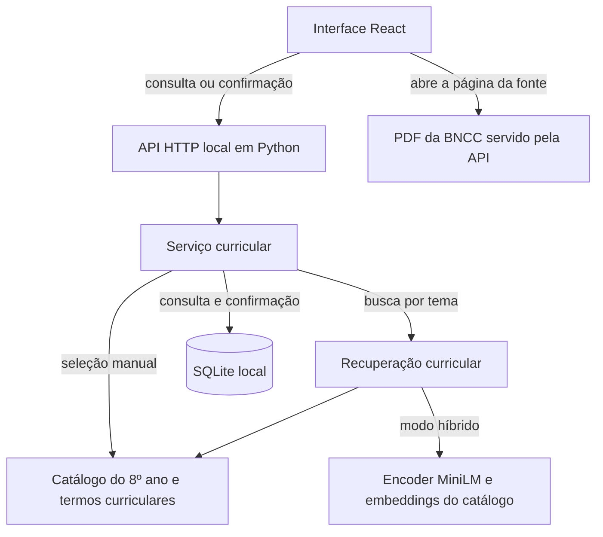

# Capítulo 4 — Arquitetura da solução
## Incremento de recuperação e confirmação curricular

**Registro de implementação de 5 de novembro de 2026.** O primeiro trecho do UC04 permite ao professor transformar a intenção de ensinar um tema em uma escolha curricular explícita. O resultado deste incremento é o contexto da aula associado a uma habilidade da BNCC de Computação, disponível para consumo por um futuro agente de objetivos.

### 4.1 Requisitos atendidos

A especificação técnica v2.0 serviu de referência para os identificadores abaixo. O recorte implementado abrange as 11 habilidades do 8º ano do Ensino Fundamental, de EF08CO01 a EF08CO11. A escolha desse ano decorreu da disponibilidade de catálogo estruturado e embeddings correspondentes no projeto inicial.

| Incremento testado | Requisito da v2.0 | Evidência observada |
|---|---|---|
| Entrada de contexto | RF04 e RF05 | A interface coletou ano, tema, duração em minutos, tipo de aula e recursos. O backend rejeitou ano fora do recorte, texto obrigatório em branco e duração inválida antes da busca. |
| Recuperação por tema | RF06 | O terminal original e a interface integrada retornaram EF08CO03 na primeira posição para “quero ensinar ordenação”. O resultado incluiu descrição, eixo, objeto de conhecimento e referência. |
| Escolha manual | RF07 | A opção “Escolher no catálogo” apresentou as 11 habilidades. No navegador foi possível selecionar e confirmar EF08CO09. |
| Confirmação pelo professor | RF08 e RN01 | O primeiro resultado apareceu como candidato. A confirmação exigiu uma escolha explícita entre os candidatos. O contrato para geração ficou disponível após essa ação. |
| Origem curricular | RNF02, parcialmente atendido | A seleção guardou a descrição, os exemplos e as páginas do PDF. A identidade do arquivo usado neste teste está registrada abaixo. O versionamento automático da fonte por execução permanece previsto. |

O projeto recebido continha uma interface React/Vite com um plano demonstrativo de conteúdo fixo. O código da busca curricular residia em um script Python interativo. A implementação conservou essas tecnologias e separou a função de busca da leitura pelo terminal, permitindo que a API web invoque o mesmo mecanismo de recuperação. O backend também introduziu a persistência local das consultas e das confirmações em SQLite. A autenticação e a propriedade de planos por usuário pertencem a etapas posteriores da especificação.

### 4.2 Fluxo executado pelo professor

1. O professor informa o **8º ano**, o tema **quero ensinar ordenação**, a duração de **50 minutos**, a modalidade **Computação desplugada** e os recursos **papel e cartões**. Ano e tema delimitam a busca. Duração, modalidade e recursos acompanham a escolha até a geração.
2. Ao acionar **Consultar habilidades**, o professor recebe uma lista ordenada. Pode conferir o texto da habilidade e abrir o documento-fonte. A página física 52 do PDF (48 impressa) contém o código e a descrição de EF08CO03. Na página física 53 (49 impressa) aparecem a explicação e os exemplos com algoritmos de ordenação. O campo `pagina_pdf` do catálogo original apontava para essa segunda página.
3. O professor seleciona **EF08CO03 — Utilizar algoritmos clássicos de manipulação sobre listas** e aciona **Confirmar habilidade**. Também pode consultar o catálogo completo e escolher outra habilidade pertinente.
4. O sistema apresenta o contexto confirmado. A opção **Ver entrada da geração (JSON)** expõe a versão do contrato, o identificador da consulta, o contexto e o registro curricular. Ao recarregar a página na mesma aba, o sistema recupera a confirmação.

**Resultado técnico observado.** Para a consulta curta, o modelo atribuiu a EF08CO03 similaridade de **0,3898**. O bônus curricular de **0,3500** elevou a pontuação a **0,7398**. A segunda colocada, EF08CO11, obteve **0,5766**. Essa diferença ilustra a contribuição das palavras-chave do protótipo para a ordenação dos candidatos. As pontuações expressam o critério de ordenação deste mecanismo. A adequação pedagógica e a pertinência em outros temas exigem avaliação própria.

O ensaio foi repetido com a frase completa “Quero ensinar ordenação para uma turma do 8º ano. Tenho 50 minutos, papel e cartões.” no campo de tema. EF08CO03 permaneceu em primeiro, com pontuação híbrida de **0,7352**. A interface apresenta campos estruturados para que o professor confirme os dados da turma. O modo lexical opcional também retornou EF08CO03 em primeiro, com bônus **0,3500**, e permite demonstrar a escolha sem carregar o encoder.

### 4.3 Componentes executados neste incremento

No modo híbrido, o serviço calcula o vetor da consulta com o encoder multilíngue MiniLM. A busca compara esse vetor normalizado com os embeddings previamente normalizados das habilidades por produto escalar em NumPy e soma o bônus curricular do código original. O índice FAISS é um produto da ingestão inicial. A consulta executada neste recorte usa diretamente a matriz de embeddings. O modo lexical reutiliza apenas a parcela de correspondência curricular. A tela identifica o método utilizado.

Ao criar uma consulta, o serviço registra o contexto e os candidatos efetivamente retornados. Ao receber o código selecionado, verifica sua presença nesse conjunto e grava a confirmação em uma transação. Uma repetição com o mesmo código recupera o mesmo resultado. Uma tentativa concorrente de confirmar outro código para a mesma consulta recebe conflito. Essa fronteira evita que um código digitado livremente passe a orientar a geração.

| Operação da API | Efeito verificado |
|---|---|
| `POST /api/consultas` | Valida o contexto e devolve identificador, método e candidatos. |
| `POST /api/consultas/{id}/confirmar` | Recebe o código selecionado e vincula a habilidade recuperada ao contexto. |
| `GET /api/consultas/{id}` | Recupera a consulta e seu estado atual. |
| `GET /api/consultas/{id}/entrada-geracao` | Retorna HTTP 409 antes da confirmação. Depois, fornece o contrato JSON 1.0 com a habilidade confirmada. |

### Evidências e limites

O script original foi executado com os embeddings anexados e o modelo `sentence-transformers/paraphrase-multilingual-MiniLM-L12-v2`, revisão `e8f8c211226b894fcb81acc59f3b34ba3efd5f42`. O teste de regressão comparou os cinco primeiros códigos e as pontuações da primeira habilidade. O arquivo `docs/evidencia_ordenacao.json` contém o ranking e a entrada confirmada capturados na execução web.

Os oito testes automatizados cobriram o ranking híbrido, busca lexical, catálogo completo, entradas inválidas, ausência de correspondência lexical, confirmação restrita aos candidatos, persistência, repetição e concorrência. No Chromium, foram exercitados os dois modos de busca, o formulário obrigatório, a confirmação explícita, o resumo, a resposta da API antes e depois da escolha, a recarga da aba e a escolha manual em largura de celular. As 11 descrições do catálogo foram conferidas contra a coluna de habilidades da página correspondente do PDF anexo. A demonstração corresponde a uma aplicação local, individual, com dados didáticos de teste.

**Fonte utilizada:** `aula-ia-backend/data/BNCCComputacao.pdf`, *Computação na Educação Básica — Complemento à BNCC*, páginas físicas 52–55. SHA-256 do PDF: `60aab0b192acf867bc582dc06678cd8f3bc597e8f1b65256fc7bf04190bb793d`. A identificação dos requisitos segue o *Documento de Visão e Especificação Técnica*, versão 2.0 de 05/11/2026.

### Próximos incrementos previstos

| Marco | Critério de aceite proposto |
|---|---|
| Primeiro plano na web até **08/11/2026** | O agente de objetivos recebe o contrato confirmado. O de sequência recebe contexto, habilidade e objetivos. O de avaliação recebe esses dados e as atividades. O integrador exibe o plano candidato e a tela permite inspecionar as entradas e saídas de cada etapa. Esse marco inicia RF09, RF10 e a rastreabilidade de RF21. |
| MVP demonstrável e primeira versão completa do capítulo até **13/11/2026** | Reexecutar um cenário de ponta a ponta, arquivar as evidências e atualizar as seções 4.1 a 4.3 segundo os componentes que realmente rodarem. |
| Após a primeira geração | Introduzir IA Juiz, critérios de verificação e ciclo de correção. Histórico e exportação de planos em PDF vêm depois do fluxo central. O experimento com alunos do PROFCOMP pertence a outra etapa. |
