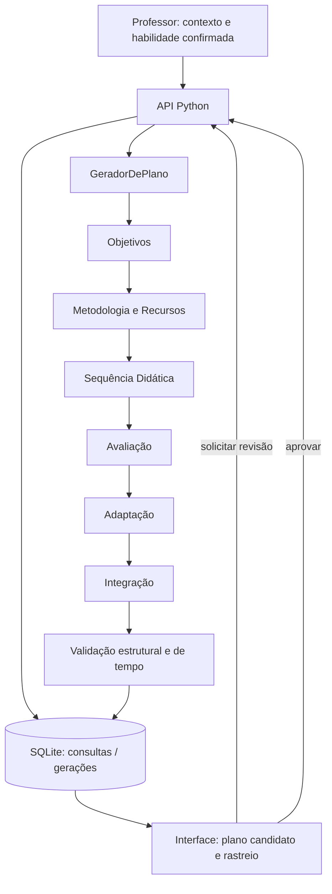

# Capítulo 4 — Arquitetura da solução
## Incremento 02 — Geração do plano candidato e aprovação docente

**Registro de implementação: 5 de novembro de 2026.** Este incremento sucede a recuperação e a confirmação curricular documentadas no Incremento 01. A aplicação passa a permitir que, após confirmar uma habilidade da BNCC de Computação, o professor solicite a composição de um plano candidato, veja a estrutura pedagógica construída, inspecione o encadeamento de componentes, gere revisões alternativas e registre sua aprovação.

### Recorte funcional implementado

O backend preserva o catálogo curricular original e a API de consulta/confirmação. A execução de geração é proibida enquanto a consulta não tiver habilidade confirmada. O plano associa código e descrição da habilidade, ano, tema, duração, tipo de aula, objetivos de aprendizagem, metodologia, recursos, etapas temporizadas, avaliação e adaptações. O SQLite passa a manter tabela de gerações com identificador, revisão, estado (`processando`, `rascunho` ou `aprovado`), resposta estruturada e data de criação. A revisão mais recente é recuperada na mesma consulta após reinício do servidor.

O fluxo foi organizado em seis papéis: **Objetivos → Metodologia e Recursos → Sequência Didática → Avaliação da Aprendizagem → Adaptação → Integração**. Cada componente recebe o contexto original, a habilidade oficial e as saídas já produzidas. A ordem de execução foi definida para respeitar a dependência dos componentes. A trilha registra o nome da etapa, um resumo das entradas disponíveis e as saídas estruturadas.

A implementação possui dois modos distintos. No **modo demonstrativo**, funções determinísticas produzem um exemplo de plano a partir de regras e do contexto fornecido; portanto, esse resultado não comprova desempenho de IA generativa. No **modo IA**, cada papel executa uma requisição separada ao provedor de LLM, com saídas JSON e validação posterior. A integração real com a API e a qualidade pedagógica de suas respostas **não foram avaliadas neste registro**. A interface identifica explicitamente o modo utilizado.

### Regras de integridade

- A geração exige habilidade confirmada e preserva seu código.
- Os tempos de todas as etapas devem ser inteiros positivos e somar exatamente a duração informada.
- Objetivos, metodologia, recursos, sequência, avaliação e adaptações precisam estar presentes.
- Uma nova geração antes da aprovação cria nova revisão, sem sobrescrever a habilidade selecionada.
- Somente a última versão pode ser aprovada; uma versão aprovada bloqueia nova geração na mesma consulta.
- A aprovação é **humana**. Este incremento **não implementa a IA Juiz** e não deve ser apresentado como validação automática da qualidade pedagógica.

### Fluxo técnico

### Evidências do incremento

Foram executados 15 testes locais de unidade/integração, abrangendo regressões da busca curricular, exigência de confirmação, geração de rascunho, preservação da habilidade, conferência da soma dos tempos, rastreabilidade, revisões, aprovação, bloqueios e concorrência. O teste opcional de busca híbrida requer um modelo externo e não integrou a execução por padrão. As operações HTTP locais foram verificadas diretamente. A interface foi exercitada com Chromium em ambiente de teste isolado, utilizando uma ponte controlada para o backend HTTP: consulta, confirmação, geração, nova versão e aprovação funcionaram sem erros de JavaScript. O acesso direto do navegador de teste ao endereço local estava bloqueado, e o teste foi adaptado para utilizar conteúdo carregado na página isolada; uma verificação no computador do usuário ainda é indicada.

**Limitações.** A geração demonstrativa é baseada em regras e oferece apenas um exemplo funcional do fluxo. No modo IA, erros e incoerências possíveis precisam de testes com o provedor real e de calibração pedagógica; a validação atual é estrutural. O sistema atende ao 8º ano e funciona localmente sem autenticação. A camada de interface foi adicionada como uma extensão progressiva, com migração para componente React planejada. A avaliação pela IA Juiz, o ciclo de correção dirigida, a exportação PDF dedicada e a comparação experimental com modelo único pertencem a incrementos posteriores.
