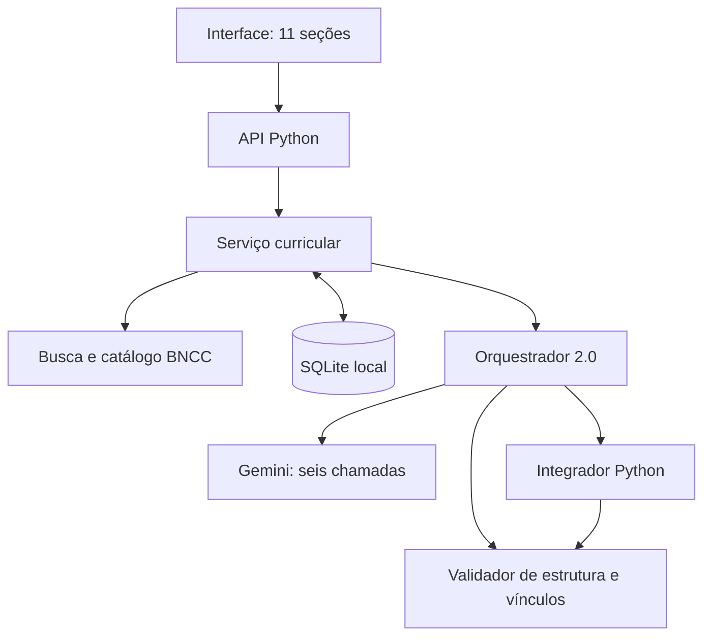

> **HISTÓRICO — não usar como diagrama vigente.** Registro de 16/11 (antes da IA Juiz integrada). Superado pelos
> [Diagramas finais](diagramas-finais.md) de 23/11/2026.

# Componentes implementados — PlanoDeAula 2.0 e Gemini

Registro: 16/11/2026, branch `feat/poc04a-gemini`. Descreve a implementação atual, com contrato completo e validação mecânica, sem reivindicar conclusão da arquitetura-alvo R2.

A ordem das seis chamadas é: objetivos → avaliação preliminar → metodologia → sequência → avaliação final → adaptação. Cada saída é validada antes de liberar dependentes. A avaliação preliminar depende dos objetivos; a final também recebe as etapas. O integrador reúne as seis saídas validadas em 11 seções sem LLM.

Cada chamada pode receber um reparo técnico com as mesmas dependências e seus diagnósticos. O serviço registra `rascunho` ou `falha`; somente aprovação humana muda para `aprovado`. O modo demonstrativo usa regras locais. SQLite é persistente por padrão; `--temporario` é optativo. O frontend reconhece 2.0 pela versão do resultado e mantém a renderização v0.1.

Juiz, correção pedagógica dirigida, rejeição e estados completos continuam previstos nos [diagramas-alvo R2](https://github.com/Carneiro-Joao/tcc-plataforma-multiagente/blob/33e8025c7bbdae8ab27c37332f2c3b9d3cc11903/docs/diagramas/diagramas-v2.1-R2.md). Após a falha parcial por complexidade do schema, uma geração real concluiu as seis etapas e a integração no protótipo, com duas recuperações de HTTP 503. Os contratos locais permanecem obrigatórios. Consulte a [evidência completa e a versão consolidada](../Prototipo_Local_2026-11-16.md).
