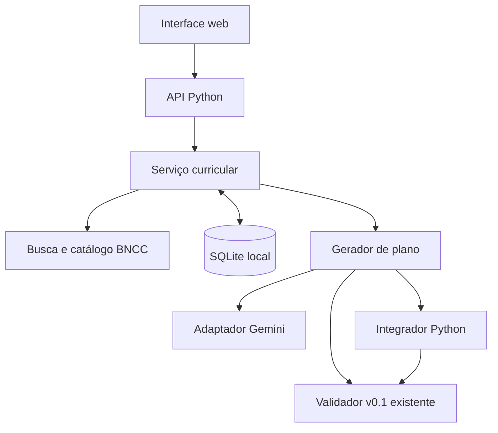

# Componentes implementados — contratos v0.1 e Gemini

Registro: 14/11/2026, branch `feat/poc04a-gemini`. Integra o adaptador inicialmente publicado em `448ea76` e os contratos de `70cfff2`, com o ajuste de alinhamento no histórico desta branch. Descreve a implementação parcial, não a arquitetura-alvo completa da R2.

O serviço exige a confirmação curricular e reserva uma revisão antes da geração. O gerador executa objetivos, metodologia, sequência, avaliação e adaptação em cinco chamadas normais ao mesmo modelo Gemini. Cada saída passa pelo validador antes de avançar. O único reparo estrutural permitido repete o especialista com as mesmas dependências e seus diagnósticos; não é correção pedagógica.

A integração monta os 13 campos do contrato v0.1 sem LLM, preservando os dados curriculares e o contexto. O serviço registra o resultado como `rascunho` ou registra `falha`; a aprovação humana altera o estado para `aprovado`. O modo demonstrativo usa regras locais. SQLite é persistente por padrão; `--temporario` é optativo.

A avaliação preliminar, os vínculos de objetivos/evidências, as 11 seções do PlanoDeAula 2.0, o Juiz e a rejeição explícita continuam previstos nos [diagramas-alvo R2](https://github.com/Carneiro-Joao/tcc-plataforma-multiagente/blob/33e8025c7bbdae8ab27c37332f2c3b9d3cc11903/docs/diagramas/diagramas-v2.1-R2.md), sem serem rotulados como implementados nesta figura.
