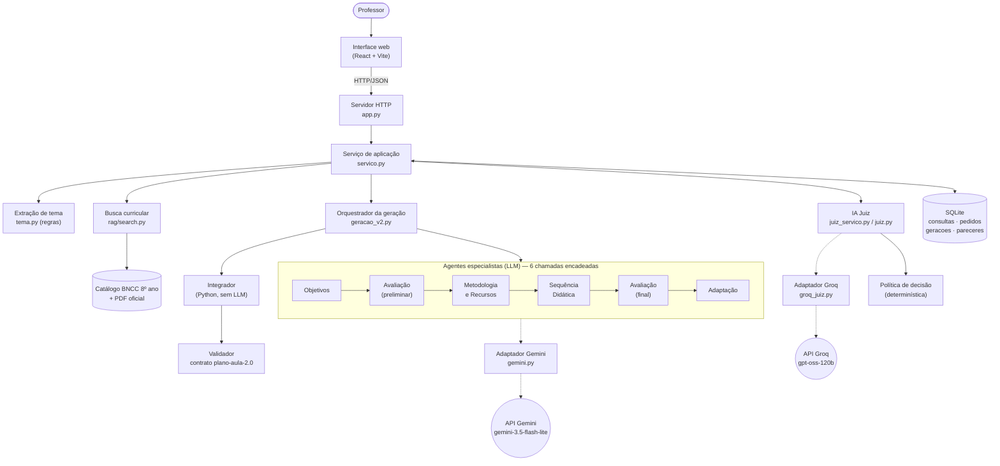
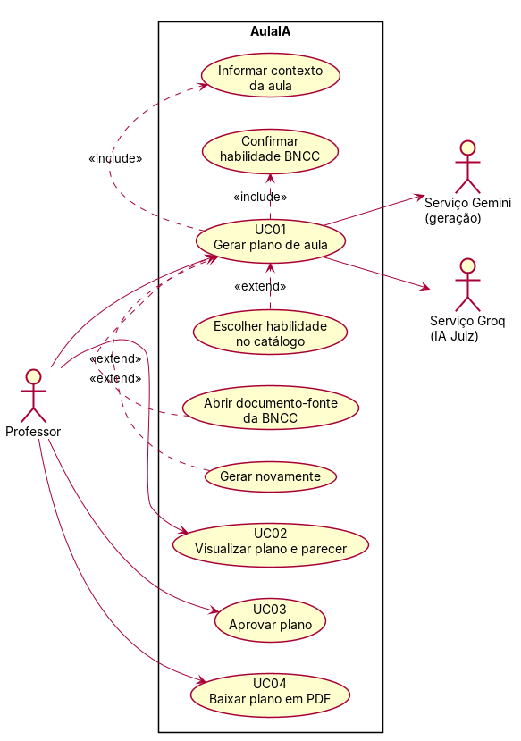
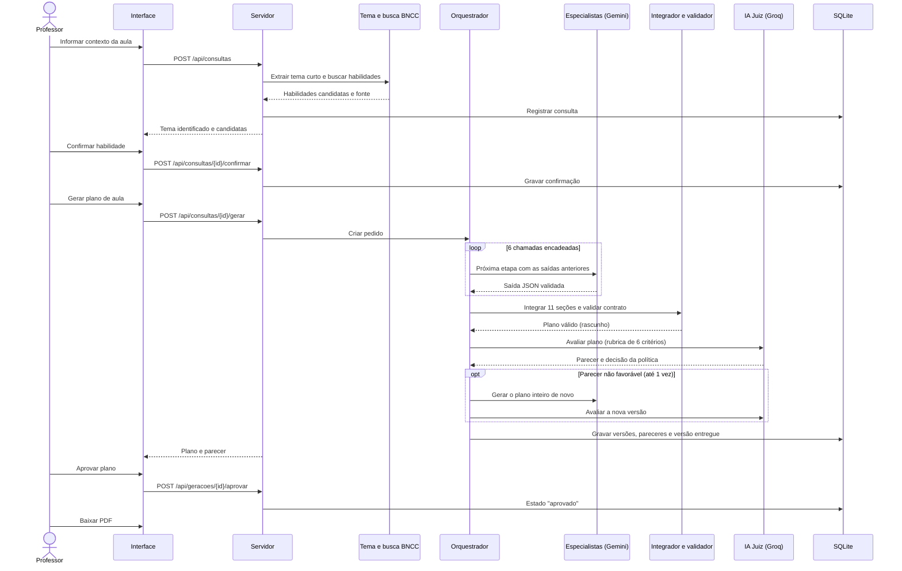
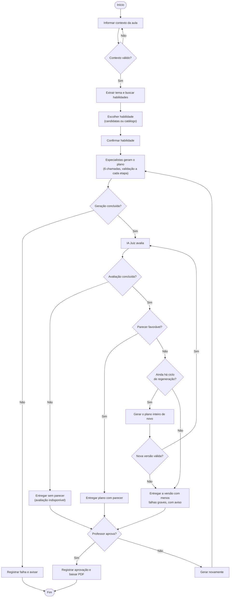
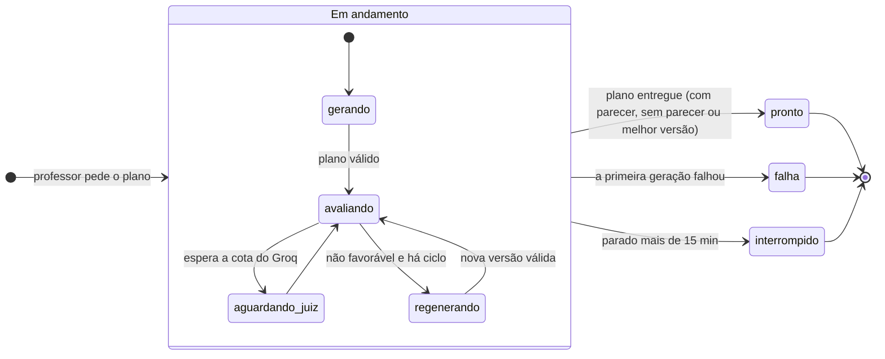
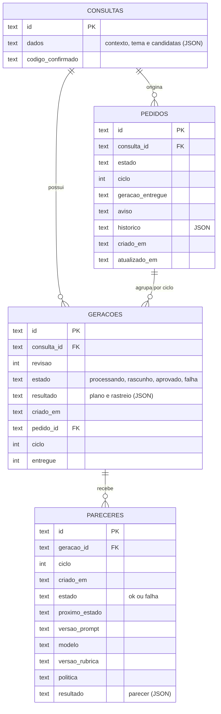
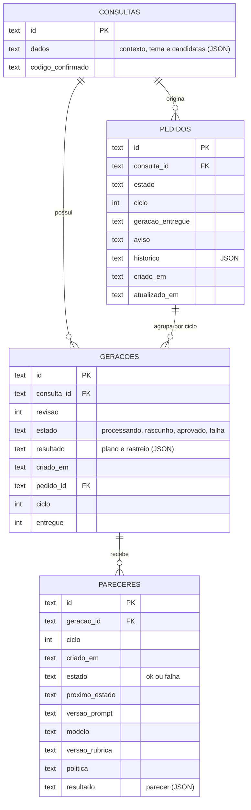

# AulaIA — Diagramas finais (conforme implementado)

**Data:** 23/11/2026 · **Situação:** versão final, aprovada pelo João; refletem o sistema congelado na `main` (`694c07c`).
Especificação correspondente: [`../especificacao/AulaIA_Especificacao_v2.2_final.md`](../especificacao/AulaIA_Especificacao_v2.2_final.md).
Substituem os diagramas v2.1-R2 (D1–D6, branch `docs/diagramas-rascunho`, commit `33e8025`), que descreviam a arquitetura-**alvo**.

**Arquivos:** fontes e imagens em [`final/`](final/) (`.mmd` Mermaid, `.puml` PlantUML, `.png` para o texto, `.svg` para ampliar).
Para regenerar: `mmdc -i final/<nome>.mmd -o final/<nome>.png -s 2 -b white` (Mermaid CLI) e
`java -jar plantuml.jar -tpng final/casos-de-uso.puml` (PlantUML + Graphviz).

| Diagrama | Onde entra no TCC | Arquivo |
|---|---|---|
| Sequência | 4.2 Navegação (o único de sequência) | `final/sequencia.png` |
| Componentes | 4.3 Modelagem (principal: estrutura dos agentes) | `final/componentes.png` |
| Casos de uso (UML) | 4.3 Modelagem | `final/casos-de-uso.png` |
| Entidade-relacionamento | 4.3 Modelagem | `final/er.png` |
| Atividades | Opcional (4.2 ou 4.3) | `final/atividades.png` |
| Estados do pedido | Opcional (4.3) | `final/estados.png` |

## 1. Componentes

Linhas tracejadas: chamadas a serviços externos, sempre por um adaptador. Integrador, validador, extração de tema e política são
determinísticos (sem LLM). Os seis blocos dos especialistas são **cinco agentes em seis chamadas** (a Avaliação tem duas passagens).

## 2. Casos de uso

Fonte PlantUML: [`final/casos-de-uso.puml`](final/casos-de-uso.puml). `<<include>>`: partes obrigatórias de UC01. `<<extend>>`:
comportamentos opcionais (catálogo, documento-fonte, gerar novamente). Inspecionar especialistas é depuração, não caso de uso.

## 3. Sequência

## 4. Atividades

## 5. Estados do pedido

Estados da **geração** (versão do plano): `processando` → `rascunho` → `aprovado`, ou `falha`. "Interrompido" não é gravado: é como o
sistema mostra um pedido em andamento parado há mais de 15 minutos.

## 6. Entidade-relacionamento (tabelas reais do SQLite)

O plano e o rastreio ficam em JSON em `geracoes.resultado`; o parecer, em `pareceres.resultado`. A versão entregue de cada pedido tem
`geracoes.entregue = 1` (e `pedidos.geracao_entregue`).

## Manutenção

Mudou contrato, dependência, estado ou responsabilidade no código? Atualizar a fonte em `final/`, regenerar a imagem e citar o commit.
