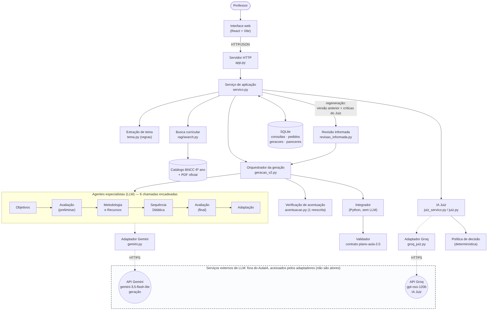
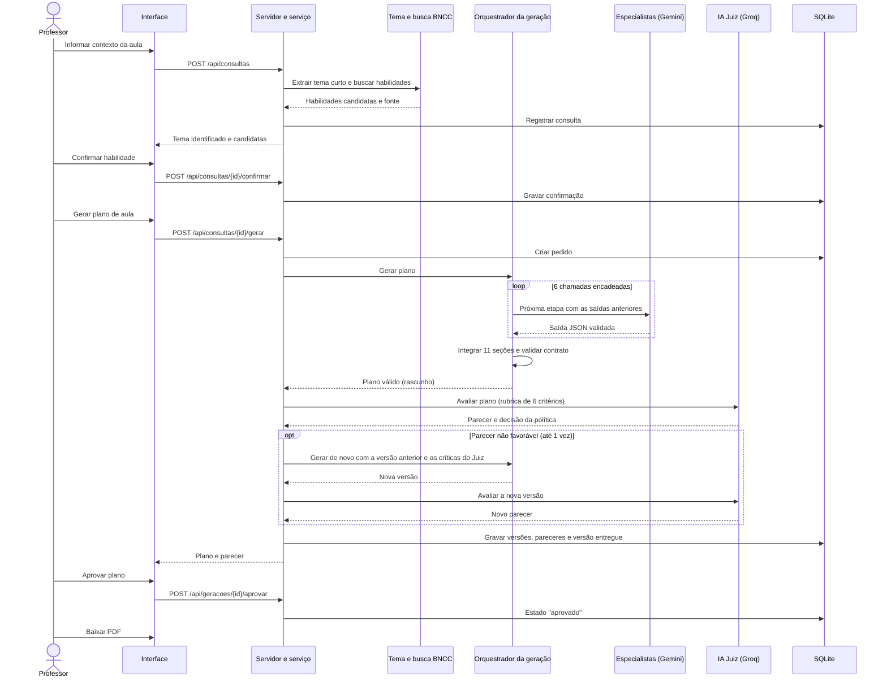
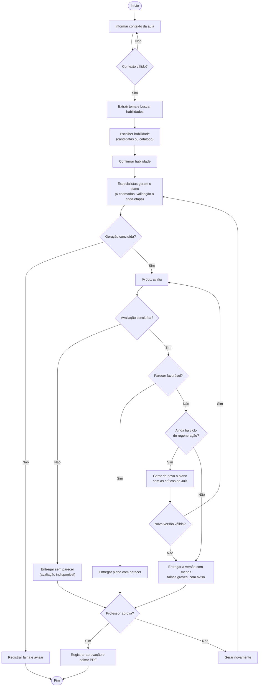
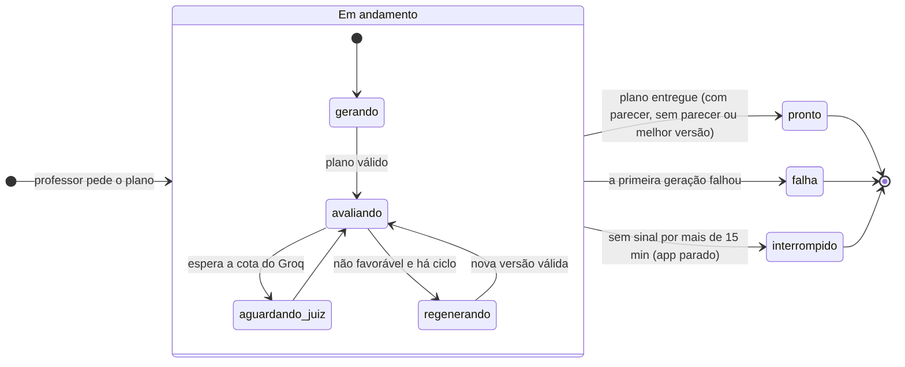
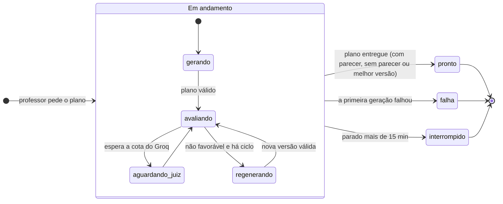
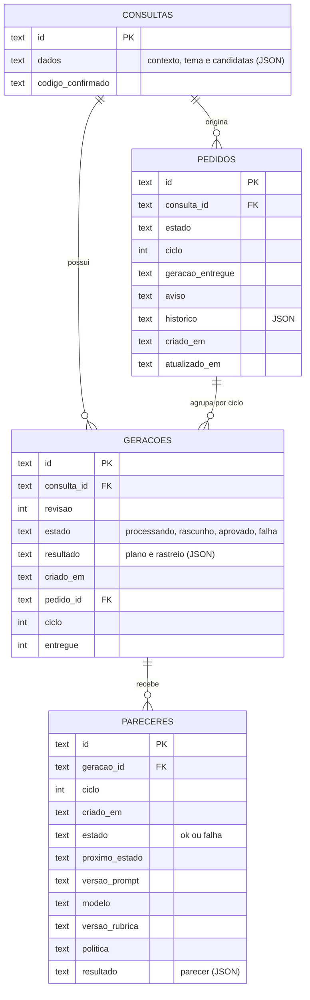
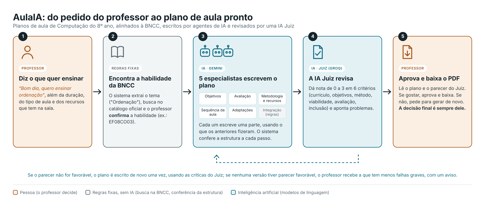
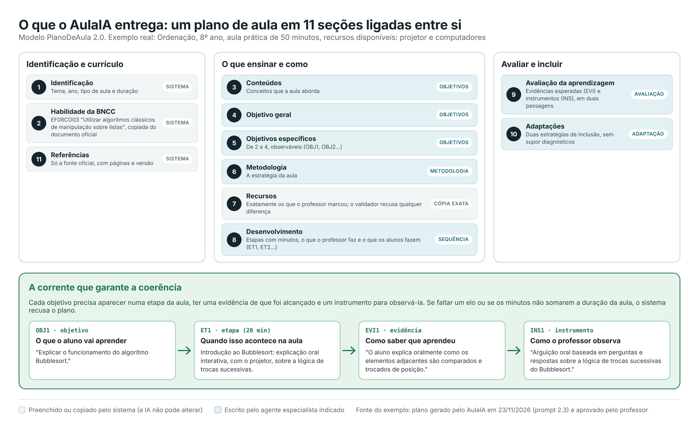

# AulaIA — Diagramas finais (conforme implementado)

**Data:** 23/11/2026 · **Situação:** versão final, aprovada pelo João; refletem o sistema congelado na `main` (`694c07c`).
Especificação correspondente: [`../especificacao/AulaIA_Especificacao_v2.2_final.md`](../especificacao/AulaIA_Especificacao_v2.2_final.md).
Substituem os diagramas v2.1-R2 (D1–D6, branch `docs/diagramas-rascunho`, commit `33e8025`), que descreviam a arquitetura-**alvo**.

**Arquivos:** fontes e imagens em [`final/`](final/) (`.mmd` Mermaid, `.puml` PlantUML, `.png` para o texto, `.svg` para ampliar).
Para regenerar: `mmdc -i final/<nome>.mmd -o final/<nome>.png -s 2 -b white` (Mermaid CLI) e
`java -jar plantuml.jar -tpng final/casos-de-uso.puml` (PlantUML + Graphviz). As figuras 1 e 6 têm fonte em HTML
(`final/visao-geral.html`, `final/estrutura-plano.html`): abrir no Chromium a 1800 px e capturar o elemento `.fig` com escala 2 (Playwright).

**Seleção para o texto (decisão de 23/11):** seis figuras, cada uma respondendo a uma pergunta do leitor, na ordem de leitura do Cap. 4.

| Ordem | Figura | Pergunta que responde | Onde entra no TCC | Arquivo |
|---|---|---|---|---|
| 1 | Visão geral (ilustrativa, sem UML) | O que é e por que importa? | Abertura do Cap. 4 | `final/visao-geral.png` |
| 2 | Casos de uso (UML) | O que o professor pode fazer? | 4.3 (ou abrindo a 4.2) | `final/casos-de-uso.png` |
| 3 | Sequência + prints das telas | Como é usar, passo a passo? | 4.2 (o único de sequência) | `final/sequencia.png` |
| 4 | Componentes + um parágrafo por agente | Do que o sistema é feito? | 4.3 (principal) | `final/componentes.png` |
| 5 | Atividades de "Gerar plano" | O que acontece quando algo não sai bem? | 4.3 | `final/atividades.png` |
| 6 | Estrutura do plano | O que exatamente o sistema entrega? | 4.3 | `final/estrutura-plano.png` |
| — | Entidade-relacionamento | Como os dados são guardados? | Apêndice (opcional) | `final/er.png` |
| — | Estados do pedido | Quais estados um pedido percorre? | Apêndice (opcional) | `final/estados.png` |
| — | Classes | — | Não usar: o plano é um documento JSON validado por contrato, não um modelo de objetos | — |

## 1. Componentes

Linhas tracejadas: chamadas a serviços externos, sempre por um adaptador. Integrador, validador, extração de tema e política são
determinísticos (sem LLM). Os seis blocos dos especialistas são **cinco agentes em seis chamadas** (a Avaliação tem duas passagens).

## 2. Casos de uso

Fonte PlantUML: [`final/casos-de-uso.puml`](final/casos-de-uso.puml). `<<include>>`: partes obrigatórias de UC01. `<<extend>>`:
comportamentos opcionais (catálogo, documento-fonte, gerar novamente). Inspecionar especialistas é depuração, não caso de uso.

## 3. Sequência

## 4. Atividades

## 5. Estados do pedido

Estados da **geração** (versão do plano): `processando` → `rascunho` → `aprovado`, ou `falha`. "Interrompido" não é gravado: é como o
sistema mostra um pedido em andamento parado há mais de 15 minutos.

## 6. Entidade-relacionamento (tabelas reais do SQLite)

O plano e o rastreio ficam em JSON em `geracoes.resultado`; o parecer, em `pareceres.resultado`. A versão entregue de cada pedido tem
`geracoes.entregue = 1` (e `pedidos.geracao_entregue`).

## 7. Visão geral (figura ilustrativa)

Para leitores sem formação técnica: cinco passos, com a separação entre pessoa, regras fixas e IA. Fonte: [`final/visao-geral.html`](final/visao-geral.html).

## 8. Estrutura do plano de aula

As 11 seções do PlanoDeAula 2.0, quem preenche cada uma e a corrente objetivo → etapa → evidência → instrumento, com trechos
**literais** do plano aprovado na execução de 23/11/2026 pela interface (Gemini + Groq; Ordenação, aula prática, 50 min, projetor e
computadores; revisão 1, parecer "Com ressalvas"), a mesma usada nas telas do Cap. 4 do TCC. O texto da etapa ET1 é resumido; os demais
estão entre aspas. Fonte: [`final/estrutura-plano.html`](final/estrutura-plano.html).

## Manutenção

Mudou contrato, dependência, estado ou responsabilidade no código? Atualizar a fonte em `final/`, regenerar a imagem e citar o commit.
