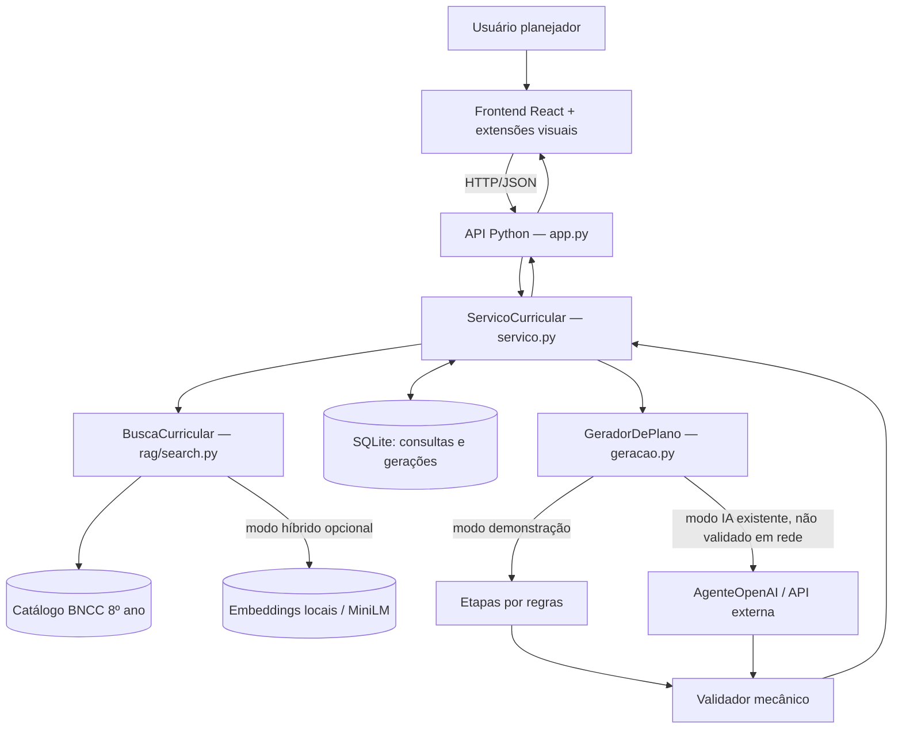
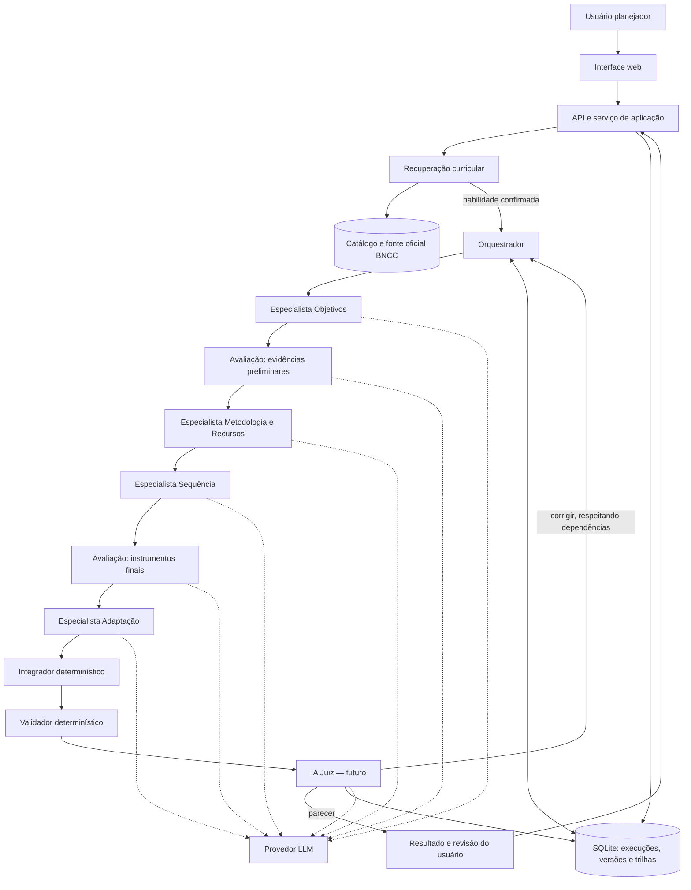
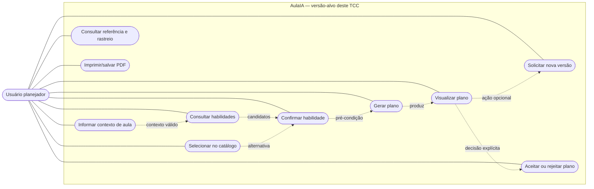
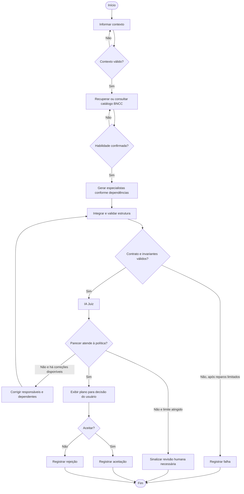
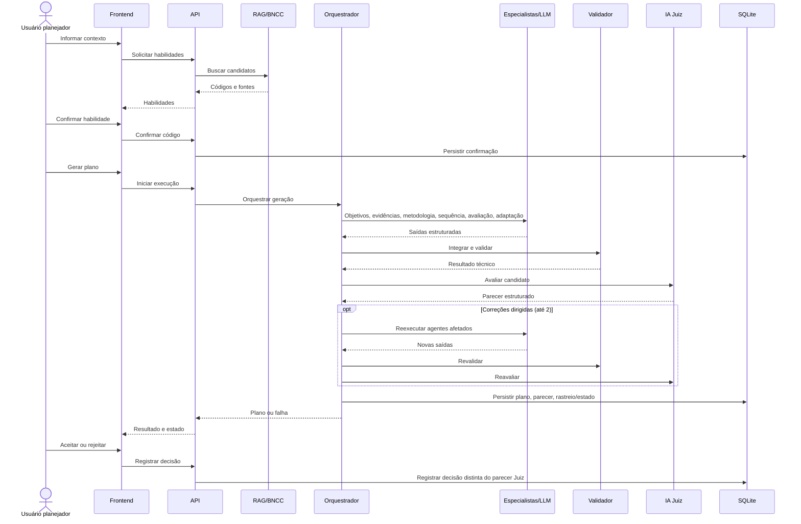
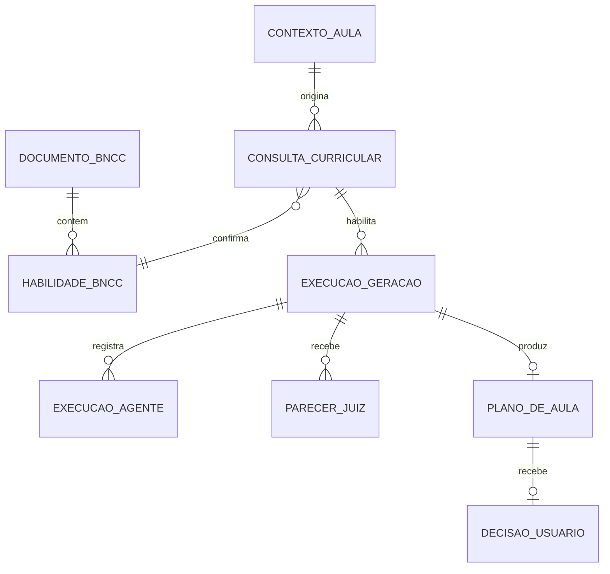

# AulaIA — Diagramas de referência v2.1-R2 (sem validação em campo)

**Estado:** escopo arquitetural **aprovado pelo autor em 10/11/2026** (MVP, RF25/UC10 e integração Python); diagramas conceituais em revisão de precisão e UML formal, alinhados à especificação v2.1-R2. Diagramas lógicos em Mermaid; o mapa de casos de uso **não é UML formal**, e a notação formal pode ser exportada em PlantUML posteriormente.

## Aprovações de arquitetura

- Cinco especializações gerativas com LLM: Objetivos, Avaliação (duas fases), Metodologia e Recursos, Sequência e Adaptação.
- Integrador é componente lógico **determinístico em Python**; não executa uma sexta chamada gerativa.
- RF25/UC10 exigem aceite ou rejeição explícitos do usuário, com estados distintos e sem aprovação automática pela IA Juiz.
- Não fazem parte do TCC: cadastro/login, histórico privado ou avaliação de planos por professores participantes.

## Legenda

- Componentes com linhas contínuas: existentes no código ou no fluxo demonstrativo das PoCs 01–03.
- Elementos com linhas pontilhadas e sufixo **futuro**: previstos para os incrementos 04–06.
- Ator do software **Usuário planejador (professor)** não significa sujeito de pesquisa; **não haverá avaliação ou recrutamento de professores neste TCC**.
- RAG lexical e híbrido são modos de recuperação; a execução no modo LLM não está validada contra API real no registro atual.

## D1 — Diagrama de componentes: estado atual (PoC 03)

**Precisão:** `GeradorDePlano` atual executa objetivos, metodologia+recursos, sequência, avaliação, adaptação e integração em ordem sequencial. A aprovação humana atual não é parecer da IA Juiz. O modo IA tem implementação de chamada HTTP mas não evidência de execução externa.

## D2 — Diagrama de componentes: arquitetura-alvo do TCC (Inc. 04–06)

**Ressalva:** este desenho é um **fluxo de dependências**, não uma representação de chamadas de rede direta agente→agente ou de microserviços separados. As chamadas ao provedor são mediadas por um adaptador. O Juiz deve ser distinguido dos validadores verificáveis por código. Em caso de falha estruturante, o orquestrador registra erro e não marca sucesso.

## D3 — Casos de uso do MVP (mapa para posterior UML)

**Correspondência formal:** UC04 é o caso central Gerar plano (inclui confirmação curricular como etapa obrigatória do fluxo, não a etapa 'gerar novamente' como UC próprio); UC06 visualização, UC07 impressão/exportação, **UC10 novo** aceitar/rejeitar. Consulta e confirmação são subfuncionalidades documentáveis, sem necessidade de promover cada passo a um UC de mesmo nível. UC01–03, UC05, UC08–09 pertencem ao backlog futuro e não entram na fronteira do MVP. Não usar `<<include>>` para representar ordem temporal.

## D4 — Atividades (arquitetura-alvo; estados simplificados)

A leitura do diagrama distingue **reparo técnico de formato** (não deve consumir orçamento de correção pedagógica) da **correção dirigida pelo Juiz** (máximo inicial de duas). Um estado `revisao_necessaria` não deve ser confundido com aprovação ou descarte automático.

## D5 — Sequência de geração (arquitetura-alvo simplificada)

## D6 — Modelo de dados conceitual (entidades da versão-alvo)

As cardinalidades são **propostas** para o domínio; a implementação atual persiste somente `consultas` e `geracoes`, com JSON de resultado, sem tabelas separadas para esses conceitos. Modelar erro sem plano: `EXECUCAO_GERACAO` pode existir sem `PLANO_DE_AULA`. Novas versões são novas execuções vinculadas à consulta, nunca mutação do plano anterior.

## Rastreabilidade e manutenção

| Mudança de escopo | Atualizar |
|---|---|
| Campo no contexto | RF04–05, RNF01/05, UC04, contratos, classes, UI, testes |
| Novo campo no plano | RF10, contratos, integrador, validador, diagrama de sequência, PDF e testes |
| Especialista ou dependência | RF09/11/12, RN14, componentes, atividades, sequência, contratos, testes |
| Estados / Juiz | RF11–13/25, RN06–09/13, atividades, casos de uso, estados, banco |
| Escolha curricular/RAG | RF06–08/24, RN01/12, componentes, atividades, testes |
| Fluxo usuário / exportação | RF16–17/20/22–25, UC04/06/07/10, UI, testes |
| Retirada de pesquisa em campo | Questões/objetivos, metodologia, escopo, UCs de pesquisa, modelo de dados, métricas e resultados esperados |

**Atualização dos diagramas é obrigatória quando a implementação alterar contratos, dependências, estados ou responsabilidades.** Cada alteração deve indicar o commit e o incremento correspondente. Versão proposta não é prova de execução.  
