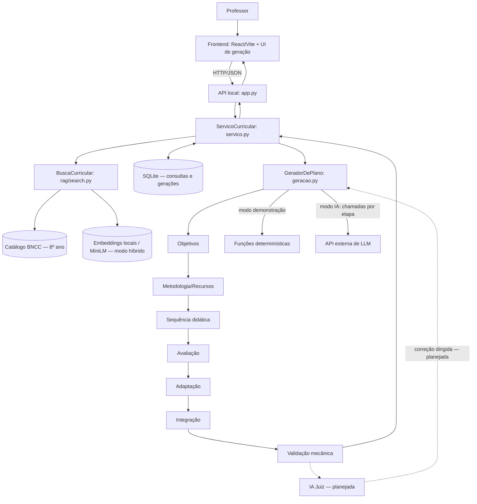
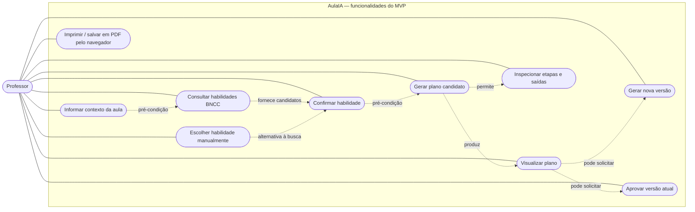

# Diagramas do TCC — rascunho arquitetural v0.1

**Estado:** proposta para revisão com João e orientador. **Referência:** implementação na branch `main` em 05/11/2026, especificação v2.0 e incrementos 01–03. Não representa implementação completa da IA Juiz.

## Convenções

- **Linha contínua:** integração ou fluxo já implementado (dependendo do modo de execução).
- **Linha tracejada:** funcionalidade prevista, ainda não validada em execução.
- A aprovação do professor **não** corresponde à aprovação da IA Juiz.
- O modo `demonstracao` usa regras determinísticas; o modo `ia` contém chamadas separadas à API, mas ainda requer validação experimental.

## 1. Diagrama de componentes — versão atual + extensões planejadas

**Nota de precisão:** os especialistas são etapas orquestradas sequencialmente em `geracao.py`; o modo IA os executa por requisições independentes ao LLM, e o modo demonstração por regras. O fluxo acima é *lógico*; não implica processos/serviços independentes nem paralelismo. A etapa de confirmação da habilidade ocorre **antes** da geração e é validada pelo backend.

**A revisar:** representação UML rigorosa de interfaces fornecidas/requeridas; separação explícita de catálogos, embeddings e PDF de origem; persistência de rastreio detalhado por execução e migração da extensão JavaScript de UI para React nativo.

## 2. Casos de uso — catálogo inicial (visão do professor)

A numeração é provisória; IDs RF/UC precisam ser reconciliados com a especificação v2.0.

**Atenção:** este é um **mapa preliminar de casos de uso**, não um diagrama UML final: as setas pontilhadas identificam relações narrativas ou pré-condições, **não** estereótipos UML `<<include>>` ou `<<extend>>`. O desenho UML definitivo será produzido após revisar os fluxos principal e alternativos do UC04. Nenhum agente interno deve aparecer como ator externo; o LLM poderá ser modelado como sistema externo somente se a interação com seu serviço for relevante ao limite do sistema.

**Planejado e ainda fora do conjunto atual:** consulta do histórico multiusuário, autenticação, exportação PDF gerada no servidor, parecer da IA Juiz e correção automática, comparação com LLM único, avaliação docente estruturada. O sistema existente funciona localmente, sem autenticação.

## 3. Base de casos de uso para evoluir a cada incremento

| Caso de uso | Estado | Regra observada |
|---|---|---|
| Informar contexto da aula | Implementado | Ano recortado ao 8º, tema, duração, modalidade e recursos validados |
| Consultar habilidades | Implementado | Busca lexical ou híbrida opcional |
| Selecionar no catálogo | Implementado | Escolha dentre habilidades retornadas |
| Confirmar habilidade | Implementado | Código precisa pertencer aos candidatos; impede confirmação divergente |
| Gerar plano | Demonstrativo testado; IA pendente de avaliação externa | Requer confirmação; gera revisão registrada |
| Visualizar plano / rastreio | Implementado | Mostra saídas por etapa e modo de geração |
| Gerar nova versão | Implementado | Somente antes de aprovação |
| Aprovar plano | Implementado | Apenas última revisão; decisão humana |
| Imprimir / salvar como PDF | Implementado via navegador | Não é exportação dedicada no servidor |
| IA Juiz e correções dirigidas | Planejado | Não confundir com validadores mecânicos |

## 4. Agenda da revisão dos diagramas

1. Validar os limites do sistema no diagrama de componentes.
2. Revisar os casos de uso e as relações UML, evitando `include` e `extend` artificiais.
3. Criar o diagrama de atividades da geração com decisões e estados reais.
4. Criar o diagrama de sequência incluindo as entradas/saídas de cada etapa.
5. Consolidar o modelo de dados (consultas e gerações existentes versus entidades futuras).
6. Atualizar o Capítulo 4 quando a IA Juiz e o modo LLM forem testados, separando arquitetura proposta de evidências executadas.

> Este arquivo é um rascunho versionado para revisão. Alterações futuras devem registrar incremento, commit e diferença arquitetural, evitando reescrever o passado como se o componente já existisse.
